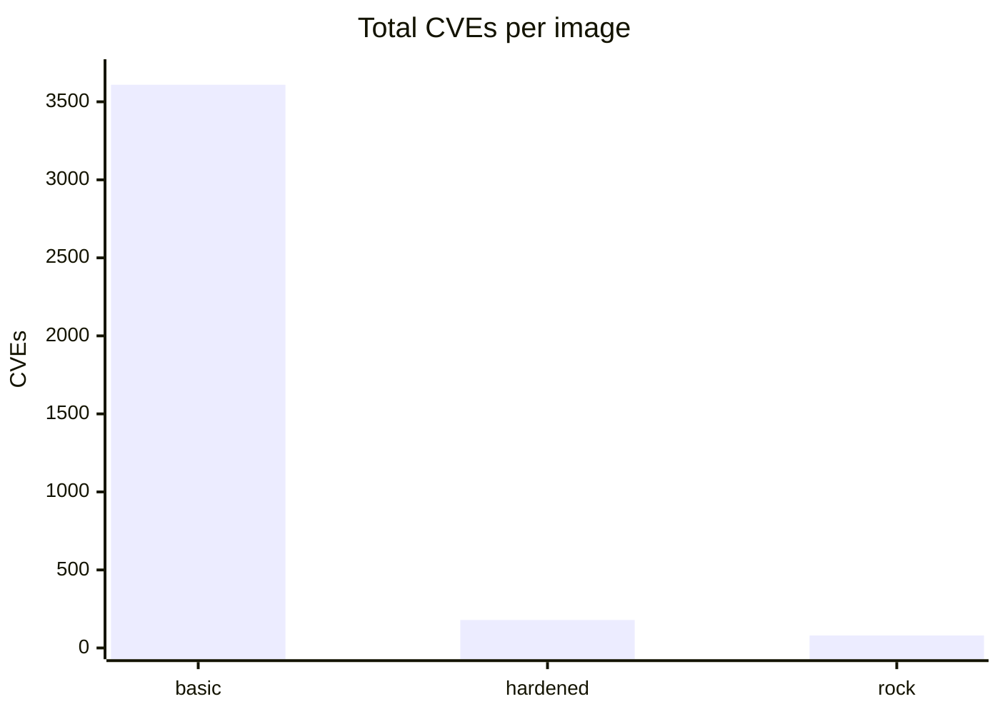
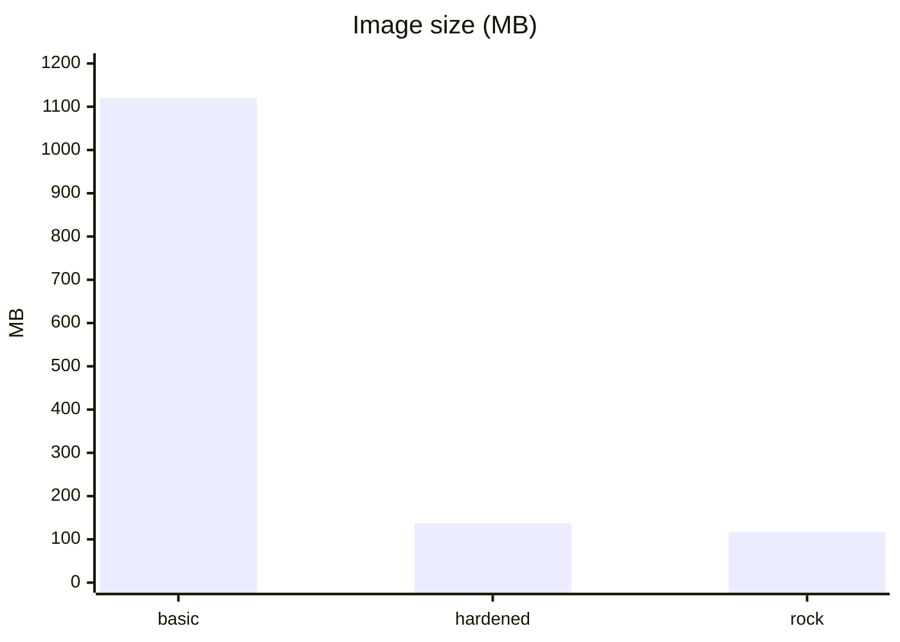
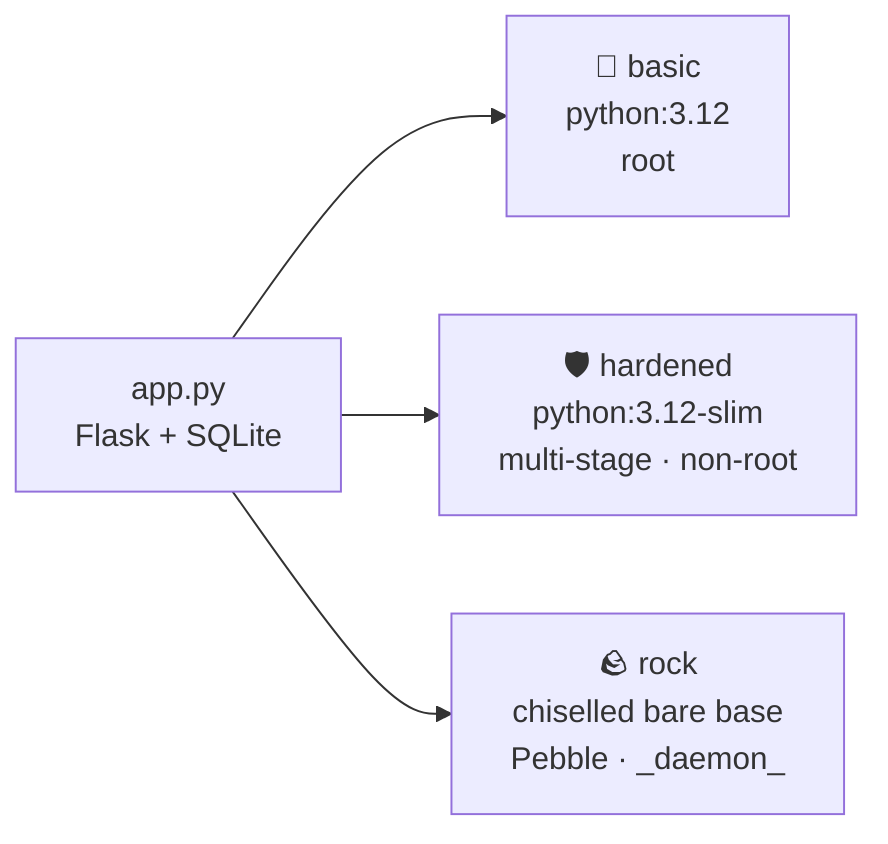

<div align="center">

# 🪨 rock-vs-docker

**One tiny Flask + SQLite notes API, packaged three ways, then measured.**

Image size · the user it runs as · known vulnerabilities

[](https://github.com/fakubwoy/rock-vs-docker/actions/workflows/ci.yml)
[](LICENSE)


</div>

---

## 📊 Results

> Scanned with Trivy 0.75 on 2026-10-14.

| Build | How | Size | Runs as | CVEs (crit / high / total) |
|---|---|--:|---|--:|
| 🐳 `Dockerfile.basic` | `python:3.12`, single stage | **1.12 GB** | ⚠️ root | 16 / 312 / **3,609** |
| 🛡️ `Dockerfile.hardened` | `python:3.12-slim`, multi-stage venv, non-root user, healthcheck | **137 MB** | `app` | 0 / 44 / **179** |
| 🪨 `rockcraft.yaml` | Rockcraft `flask-framework`, chiselled `bare` base, Pebble as entrypoint | **116 MB** <br><sub>49 MB `.rock` archive</sub> | `_daemon_` | 0 / 29 / **80** |





## 🧭 How the three builds differ



## 💡 What I learned

- **The base image does most of the work.** Going from `python:3.12` to `-slim` removed about 95% of the CVEs before touching any app code.
- **The chiselled rock has zero OS package CVEs.** Every finding left is in software I chose to ship: the Flask/gunicorn pins (also present in the other two images) and two Go binaries the extension bundles, Pebble and a StatsD exporter (60 of the 80). So the next step is not the base image, it is keeping those bundled binaries current.
- **Pebble gives you a service manager.** The rock runs the app under Pebble, which also starts a metrics exporter, instead of a bare `CMD`.

## 🚀 Run it

```bash
pytest -q                                   # app test
docker build -f Dockerfile.hardened -t notes:hardened .
rockcraft pack                              # needs LXD
rockcraft.skopeo --insecure-policy copy oci-archive:notes_0.1_amd64.rock docker-daemon:notes:rock
trivy image notes:rock
```

<details>
<summary>📦 Building behind a network that blocks DNS in Docker</summary>

My office network blocks DNS inside Docker builds, so the Dockerfiles install from a `wheels/` folder downloaded on the host:

```bash
pip download -r requirements.txt -d wheels
```

On a normal network you can drop `--no-index --find-links`.

</details>

## 🗂️ Repo layout

| File | Purpose |
|---|---|
| [`app.py`](app.py) | The notes API |
| [`test_app.py`](test_app.py) | pytest test |
| [`Dockerfile.basic`](Dockerfile.basic) | Naive single-stage build |
| [`Dockerfile.hardened`](Dockerfile.hardened) | Slim, multi-stage, non-root |
| [`rockcraft.yaml`](rockcraft.yaml) | Chiselled rock |
